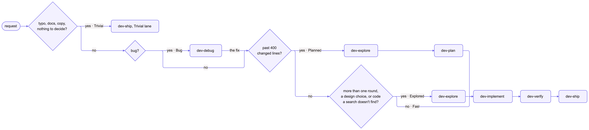

# dev-workflow

A development workflow as eight portable skills: five phases plus three support skills. Every phase that can be skipped carries a written criterion for when.

## Layout

```
dev-workflow/
├── router.md          # the router: lanes, branching, terms, four global rules
├── install.sh         # installs the skills and the router block
├── README.md
├── evals/             scenarios that check the skills — not installed
└── skills/
    ├── dev-explore/       analysis — facts in parallel, decisions in rounds
    ├── dev-plan/          spec → tasks with interface contracts
    ├── dev-implement/     direct, or one sub-agent per task with a ledger
    ├── dev-verify/        evidence → spec compliance → fresh review
    ├── dev-testing/       the test discipline
    ├── dev-debug/         reproduce → root cause → the fix that deletes
    ├── dev-ship/          Trivial lane, one commit per task, integration
    └── dev-skills/        maintain this set
```

One `SKILL.md` per skill, with four reference files read only when needed: `dev-implement/references/delegated.md`, the plan-execution mode, read only when there is a plan, so small changes don't load it; `dev-verify/references/review.md`, the fresh reviewer's brief and how its findings are ruled on, read only when a review is dispatched; `dev-plan/references/builder-check.md`, the fresh read of a plan by someone who can't ask, read once the plan's self-review is done; and `dev-testing/references/property-based.md`, read only once a property test is worth writing.

## How it routes



Around that path:

- `dev-testing` is loaded before any test or code is written, in every lane that writes code.
- Unexpected behavior in any phase goes to `dev-debug`; a phase that shows the lane no longer fits switches lanes from where it is.
- `dev-verify` checks every change against the repo's agent instruction file and updates it when the change made it wrong; `dev-skills` runs when editing this skill set.

`router.md` is the authority: the five lanes and when each fits, branching, the terms the skills share, the four rules that hold everywhere — including the only things the work stops to ask. The installer puts it in the agent's instruction file. In short:

- A **trivial** edit runs from `dev-ship`; a **bug** starts in `dev-debug`; a **fast** change goes straight to `dev-implement`; an **explored** one settles its decisions in `dev-explore` first; a **planned** one, past 400 changed lines, adds a spec and a plan, executed by sub-agents one task at a time in slices that ship as chained PRs.
- Tests come first and are proven: watched fail, regression tests red by reverting the fix.
- Only what was asked: every new surface justifies itself against a requirement, and `dev-verify` traces every hunk, surface and changed test or check back to the spec or the request.
- One task, one commit, and history is never rewritten. Decisions live in the PR body, and on the longer lanes in a git-ignored ledger.
- The work stops only for what the user must answer — their decisions and the facts only they hold — and decides the rest, recording each one.

## Install

```
curl -fsSL https://raw.githubusercontent.com/andresdigiovanni/dev-workflow/main/install.sh | bash
```

This asks which agent(s) to configure — Claude Code, Codex CLI, OpenCode; the ones installed on your machine start selected, and you can type several at once (`1 3`, `claude,codex`) — and whether to install globally (your home directory) or into a project — the current directory, or a path you type. From your home directory only a typed path counts as a project. It then puts every skill where that agent looks for skills, and adds a block to that agent's instruction file (`CLAUDE.md` for Claude Code, `AGENTS.md` for Codex CLI and OpenCode) with the lanes and global rules from this repo's `router.md`.

Before writing anything it lists every directory and file it will touch, and what it will do to each, and asks to proceed. `--yes` skips the question; without a terminal the install proceeds after printing the list.

To target a specific project directory, or skip the interactive menu:

```
curl -fsSL .../install.sh | bash -s -- --agents claude,codex,opencode --scope global
curl -fsSL .../install.sh | bash -s -- --agents claude --scope project --dir /path/to/repo
```

`--agents` also accepts `all`. `--help` lists every option.

If you already have this repository checked out, `./install.sh` works the same way from inside it.

Codex CLI skills go to `~/.agents/skills` (or `.agents/skills` in a project). If an earlier version of this installer put them in `.codex/skills`, delete the `dev-*` folders there.

Running install again — with the same or different agents — updates an existing install in place: skills are refreshed and the instruction-file block is replaced, without touching anything else already in that file. With no options, it lists the installs it finds — globally and in the current directory — and offers to update them, install somewhere else, or uninstall.

## Uninstall

```
curl -fsSL https://raw.githubusercontent.com/andresdigiovanni/dev-workflow/main/install.sh | bash -s -- --uninstall
```

With no other options this removes every install found globally and in the current directory, after showing what it will remove.

Or, non-interactively:

```
curl -fsSL .../install.sh | bash -s -- --uninstall --agents all --scope global --yes
```

This removes the installed skills and the block added to the instruction file. Anything else in that file — anything you or another tool put there — is left exactly as it was. Skills you edited by hand are overwritten on install and removed on uninstall; a folder with the same name that isn't one of these skills is left in place with a warning.

Uninstalling through `curl` needs an internet connection, the same as installing; `./install.sh --uninstall` from a checkout doesn't. Without either, remove the `dev-*` folders from wherever the skills were installed and delete the block between `<!-- dev-workflow:start -->` and `<!-- dev-workflow:end -->` in the instruction file.

## Artifacts

| What | Where | Git |
|---|---|---|
| Spec | `docs/specs/YYYY-MM-DD-<slug>.md` | committed, when work enters the *Planned* lane |
| Plan | `docs/plans/YYYY-MM-DD-<slug>.md` | committed — argues from the spec |
| Ledger | `.dev-runs/<slug>.md` | git-ignored — the request and decisions of an *Explored* or *Planned* change, the fixes that were tried and failed, and a plan's progress task by task |

Whatever writes the ledger first makes sure `.dev-runs/` is git-ignored before writing it, per the router's *Terms*. A convention the target repository already has wins over these defaults.
