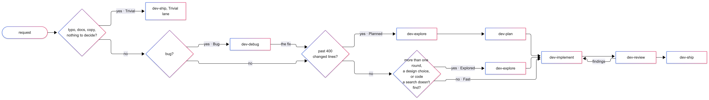

# dev-workflow

A development workflow as seven portable skills: five phases and two support skills. Every phase that can be skipped carries a written criterion for when.

## Layout

```
dev-workflow/
├── router.md          # the router: lanes, branching, terms, four global rules
├── install.sh         # installs the skills, the dispatch agents and the router block
├── README.md
├── AGENTS.md          # conventions and checks for editing this set — not installed
├── CLAUDE.md          # imports AGENTS.md, which Claude Code doesn't read on its own
├── evals/             scenarios that check the skills — not installed
├── agents/            canonical dispatch-role agent files — model + contract
│                          dev-fact-finder, dev-builder-check, dev-implementer, dev-reviewer, dev-verifier
└── skills/
    ├── dev-explore/       analysis — facts in parallel, decisions in rounds
    ├── dev-plan/          spec → tasks with interface contracts
    ├── dev-implement/     direct, or one sub-agent per task with a ledger
    ├── dev-review/        checks → a reviewer per lens → verifiers → report
    ├── dev-testing/       the test discipline
    ├── dev-debug/         reproduce → root cause → the fix that deletes
    └── dev-ship/          Trivial lane, one commit per task, integration
```

One `SKILL.md` per skill, with reference files read only when needed: `dev-implement/references/delegated.md`, the plan-execution mode, read only when there is a plan, so small changes don't load it; `dev-review/references/`, the target, the checks, the reviewers' and the verifier's briefs and the report template, each read at its step; `dev-plan/references/builder-check.md`, the fresh read of a plan by someone who can't ask, read once the plan's self-review is done; and `dev-testing/references/property-based.md`, read only once a property test is worth writing.

## How it routes



Around that path:

- `dev-testing` is loaded before any test or code is written, in every lane that writes code.
- Unexpected behavior in any phase goes to `dev-debug`; a phase that shows the lane no longer fits switches lanes from where it is.
- `dev-review` checks every change against the repo's agent instruction file and reports the line the change made wrong, which `dev-implement` then updates, or `dev-ship` on the Trivial lane; editing this skill set follows this repository's `AGENTS.md`.
- `dev-review` also runs outside the workflow: asked to review a branch or a pull request, the user's own or someone else's, it reports and changes nothing.

`router.md` is the authority: the five lanes and when each fits, branching, the terms the skills share, the four rules that hold everywhere — including the only things the work stops to ask. The installer puts it in the agent's instruction file. In short:

- A **trivial** edit runs from `dev-ship`; a **bug** starts in `dev-debug`; a **fast** change goes straight to `dev-implement`; an **explored** one settles its decisions in `dev-explore` first; a **planned** one, past 400 changed lines, adds a spec and a plan, executed by sub-agents one task at a time in slices verified one by one on a single branch that ships as one PR.
- Tests come first and are proven: watched fail, regression tests red by reverting the fix.
- Only what was asked: every new surface justifies itself against a requirement, and `dev-review`'s reviewers trace every hunk, surface and changed test or check back to the spec or the request.
- One task, one commit, and history is never rewritten. Decisions live in the PR body, and on the longer lanes in a git-ignored ledger.
- The work stops only for what the user must answer — their decisions and the facts only they hold — and decides the rest, recording each one.

## Install

```
curl -fsSL https://raw.githubusercontent.com/andresdigiovanni/dev-workflow/main/install.sh | bash
```

This asks which agent(s) to configure — Claude Code, Codex CLI, OpenCode; the ones installed on your machine start selected, and you can type several at once (`1 3`, `claude,codex`) — and whether to install globally (your home directory) or into a project — the current directory, or a path you type. From your home directory only a typed path counts as a project. It then puts every skill where that agent looks for skills, adds a block to that agent's instruction file (`CLAUDE.md` for Claude Code, `AGENTS.md` for Codex CLI and OpenCode) with the lanes and global rules from this repo's `router.md`, and installs the dispatch-role agents — `dev-fact-finder`, `dev-builder-check`, `dev-implementer`, `dev-reviewer`, `dev-verifier`, each pinning the model its role runs on — to that agent's agents directory (Claude Code: `.claude/agents/`; OpenCode: its agents directory; pi: the agent directory's `agents/`). Codex CLI gets its agents as TOML custom-agent files in its `agents/` directory — `.codex/agents/` — with the body as `developer_instructions`, the model as the file's `model` key, and the effort as `model_reasoning_effort`. The skills say to use these agents when they exist and fall back to plain sub-agents otherwise, so an install without them changes nothing.

The files under `agents/` are canonical source, one per role, and are never installed as-is. The `model` line carries the `<model>` placeholder; the installer fills it from `agents/models.toml` — the role's entry for the harness being installed, else that harness's `default` — so the same source file installs a different model per harness. The `effort` line carries the `<effort>` placeholder, filled from the role's entry in the `[<harness>.effort]` table of the same file; a role with no entry gets no effort line. On a terminal the installer asks for each model of the selected harnesses, then each effort, one question per role, with the `models.toml` value as the default — Enter keeps it. `--models PATH` skips the questions and reads a `models.toml` of your own instead, its effort tables included. The other field names follow the harness that reads them. What the install renames, per harness:

| Canonical | omp | opencode | Claude Code | Codex CLI |
| --- | --- | --- | --- | --- |
| `model: <model>` | `model: openai/gpt-6.2-sol` (models.toml) | `model: openai/gpt-6.2-sol` (models.toml) | `model: claude-opus-5-5` (models.toml) | `model = "gpt-6.2-sol"` (models.toml) |
| `effort: <effort>` | `thinking-level: high` (models.toml) | — (joins the model) | `effort: high` (models.toml) | `model_reasoning_effort = "high"` (models.toml) |
| — (implicit) | — | `model: openai/gpt-6.2-sol#high` | — | — |
| `mode: subagent` | — | `mode: subagent` | — | — |
| `tools: [read, grep]` | `tools: [read, grep]` | — (reads no tools field) | `tools: Read, Grep` | — (inherits the parent's) |
| the body | system prompt | system prompt | system prompt | `developer_instructions = """…"""` |

Codex agents are TOML files (`.codex/agents/<role>.toml`), not Markdown: the canonical frontmatter becomes `key = "value"` lines and the body a `developer_instructions` multiline string.

Copying these files by hand installs nothing. Agent files carry the `dev-` prefix, like the skills, and the installer only replaces or removes a file whose `name:` is one of these roles: another file with the same name is left in place with a warning. Building the agents needs `python3`: without it the install stops before writing anything. If an agent still can't be built (a malformed `--models` file), the agent already installed is kept, the install finishes the skills and router block, then exits with an error naming how many agents failed. A model or effort typed at a question can't contain spaces; the question is asked again.

Before writing anything it lists every directory and file it will touch, and what it will do to each, and asks to proceed. `--yes` skips the question; without a terminal the install proceeds after printing the list.

To target a specific project directory, or skip the interactive menu:

```
curl -fsSL .../install.sh | bash -s -- --agents claude,codex,opencode --scope global
curl -fsSL .../install.sh | bash -s -- --agents claude --scope project --dir /path/to/repo
```

`--agents` also accepts `all`. `--help` lists every option.

If you already have this repository checked out, `./install.sh` works the same way from inside it.

Codex CLI skills go to `~/.agents/skills` (or `.agents/skills` in a project). If an earlier version of this installer put them in `.codex/skills`, delete the `dev-*` folders there.

Pi shares the Codex CLI destinations: `~/.agents/skills` (or `.agents/skills` in a project) — the standard Agent Skills location pi reads, whatever the fork. The router block goes to pi's agent directory: `~/.omp/agent/AGENTS.md` when the omp fork of pi is installed (a `~/.omp` directory exists), `~/.pi/agent/AGENTS.md` on the original pi.

Running install again — with the same or different agents — updates an existing install in place: skills are refreshed, a skill an earlier version installed and this one no longer ships is removed, and the instruction-file block is replaced, without touching anything else already in that file. With no options, it lists the installs it finds — globally and in the current directory — and offers to update them, install somewhere else, or uninstall.

## Uninstall

```
curl -fsSL https://raw.githubusercontent.com/andresdigiovanni/dev-workflow/main/install.sh | bash -s -- --uninstall
```

With no other options this removes every install found globally and in the current directory, after showing what it will remove.

Or, non-interactively:

```
curl -fsSL .../install.sh | bash -s -- --uninstall --agents all --scope global --yes
```

This removes the installed skills and the block added to the instruction file. Anything else in that file — anything you or another tool put there — is left exactly as it was. Skills you edited by hand are overwritten on install and removed on uninstall; a folder with the same name that isn't one of these skills is left in place with a warning.

Uninstalling through `curl` needs an internet connection, the same as installing; `./install.sh --uninstall` from a checkout doesn't. Without either, remove the `dev-*` folders from wherever the skills were installed and delete the block between `<!-- dev-workflow:start -->` and `<!-- dev-workflow:end -->` in the instruction file.

## Artifacts

| What | Where | Git |
|---|---|---|
| Spec | `docs/specs/YYYY-MM-DD-<slug>.md` | committed, when work enters the *Planned* lane |
| Plan | `docs/plans/YYYY-MM-DD-<slug>.md` | committed — argues from the spec |
| Ledger | `.dev-runs/<slug>.md` | git-ignored — the request and decisions of an *Explored* or *Planned* change, the fixes that were tried and failed, and a plan's progress task by task |

Whatever writes the ledger first makes sure `.dev-runs/` is git-ignored before writing it, per the router's *Terms*. A convention the target repository already has wins over these defaults.
